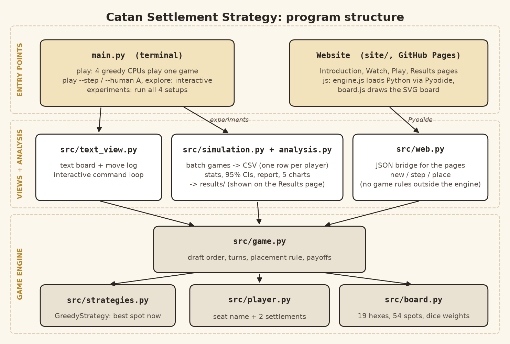

# catan-settlement-strategy

A simplified *Settlers of Catan* opening: four players draft two settlements each on a hex
board. Simulations test whether the **snake draft** (A B C D D C B A) evens out the advantage
of picking first, compared with the **standard** order (A B C D A B C D), and whether keeping
6s and 8s apart on the board helps.

**Authors:** Quentin Drucker and Emmett Manning
**Course:** COM313 Algorithmic Game Theory, Professor Christine Chung
**Website (presentation):** https://quentin-drucker.github.io/catan-settlement-strategy/

## The model in brief

- The board has 19 hex tiles with Catan's number tokens. Settlements go on the 54 corners.
- A spot is worth the dice weights of its tiles added up. A number's dice weight is how many of
  the 36 two-dice rolls give that number:
  - 6 or 8 = 5, 5 or 9 = 4, 4 or 10 = 3, 3 or 11 = 2, 2 or 12 = 1, desert = 0
  - e.g. a spot touching an 8, a 5 and a 9 is worth 5 + 4 + 4 = 13
- A settlement blocks its own corner and every corner next to it.
- A player's payoff is the value of their two spots. The computer players are greedy: they always
  take the best open spot.
- Left out on purpose: roads, resource types, trading, the robber and development cards.

## Setup

Needs Python 3.10+ (tested on 3.12). Only outside packages: matplotlib (charts) and pytest.

```
git clone https://github.com/quentin-drucker/catan-settlement-strategy.git
cd catan-settlement-strategy
python -m pip install -r requirements.txt
```

- Working from the submitted ZIP instead: unzip, then `cd` into the folder and run the
  install line.
- Windows: if `python` isn't found, use `py` instead (e.g. `py main.py play --seed 42`).
- Every command below runs from the project folder.

## Run it

| Command | Result |
|---|---|
| `python main.py play --seed 42` | Four computer players play one game; shows the board, the moves and the scores |
| `python main.py play --seed 42 --draft standard` | Same board, standard order |
| `python main.py play --seed 42 --step` | Shows the board after every move; press Enter for the next one |
| `python main.py play --seed 42 --human A` | Play seat A against three computer players |
| `python main.py explore --seed 42` | Place all 8 settlements yourself |
| `python main.py experiments --games 10000 --out check` | Quick re-run of all the experiments (~30 s) |
| `python -m pytest` | Runs the tests; should end with `162 passed` |

Options for `play` / `explore`:
- `--seed N`: the same seed always gives the same board and the same game. Leave it out for a
  random seed (printed at the top so the game can be replayed).
- `--board separated|random|classic`: `separated` (default) = no 6 or 8 next to another 6 or 8.
  `classic` = the rulebook layout (tokens A-R in a spiral, skipping the desert); the seed places the desert.
- `--draft snake|standard`: `snake` is the default.
- `python main.py --help` and `python main.py play --help` list everything.

### Reading the output

Expected end of `python main.py play --seed 42`:

```
Turn 1: Player A chooses vertex 22 (value 12)
Turn 2: Player B chooses vertex 29 (value 12)
...
Turn 8: Player A chooses vertex 25 (value 8)

Final payoffs:
  A: 20   (vertices 22 = 12 + 25 = 8)
  B: 20   (vertices 29 = 12 + 7 = 8)
  C: 20   (vertices 39 = 12 + 18 = 8)
  D: 19   (vertices 8 = 10 + 40 = 9)

Tie for first: players A, B, C
```

- Board labels: `22` = open spot, `x22` = blocked (next to a settlement), `A22` = player A's
  settlement, `--` = desert. Numbers inside the hexes are the tiles' number tokens.
- Turn log: who picked which spot (vertex ID) and what it was worth.
- With `--draft standard` the same 8 spots get taken, but in a different seat order.

### Interactive commands (`--step`, `--human`, `explore`)

| Type | Effect |
|---|---|
| `22` | Place on vertex 22 (on a human's turn) |
| Enter | Let the current computer player move |
| `i 22` | Inspect vertex 22: tiles, value, neighbors, legal or not |
| `v` | Switch board labels between vertex IDs and vertex values |
| `r` / `q` | Restart the same game / quit |

Illegal picks (occupied, next to a settlement, out of turn) are refused with the reason;
the game doesn't change.

## Reproduce the results

```
python main.py experiments --games 100000 --seed 0
```

- 4 setups (snake / standard x separated / random boards), 100,000 games each, ~4 minutes.
- Writes `results/summary.md`, 5 charts `results/*.png`, raw CSVs `results/raw/` (one row
  per player per game).
- The raw CSVs from the 100,000-game run are included in `results/raw/`: one file per setup
  (e.g. `separated_snake.csv`), 400,000 rows each, about 85 MB in total.
- Note: this overwrites the committed `results/`. Add `--out <folder>` to write elsewhere
  and compare.
- The same seeds give identical numbers. Expected fairness gap (best seat's average minus worst):
  snake 0.19 vs standard 3.64 on separated boards; 0.88 vs 4.46 on random boards.
- Any single game can be replayed: game `i` uses seed `i`, e.g.
  `python main.py play --seed 123 --board random --draft standard`.
- Findings and method: [docs/experiments.md](docs/experiments.md).

## Website

The presentation site (Introduction, Watch, Play, Results) runs the same Python engine in
the browser through Pyodide. Live link above; to preview locally:

```
python site/build_site.py
python -m http.server --directory _site
```

then open http://localhost:8000. Pushes to `main` redeploy it (`.github/workflows/pages.yml`).

## Project layout



```
main.py              command-line entry point (play / explore / experiments)
src/board.py         hex board, 54 vertices + adjacency, dice weights, board generation
src/game.py          draft order, turns, placement rule, payoffs
src/player.py        a seat and its settlements
src/strategies.py    greedy CPU
src/simulation.py    batch games -> CSV
src/analysis.py      statistics, report, charts
src/text_view.py     terminal board + interactive loop
src/web.py           JSON bridge between the website and the engine
tests/               pytest suite (162 tests)
results/             summary.md + charts from the 100,000-game run
site/                website pages, styles, JavaScript, fonts
docs/                experiments write-up, program structure diagram
```
