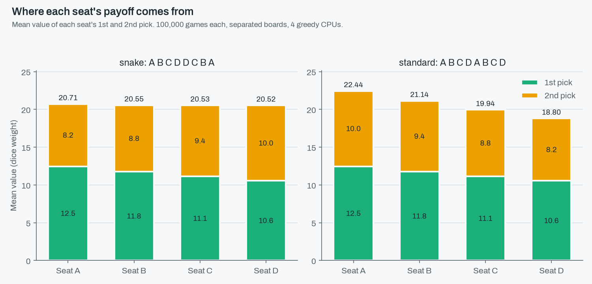
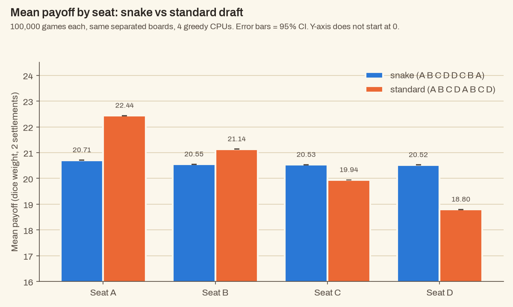
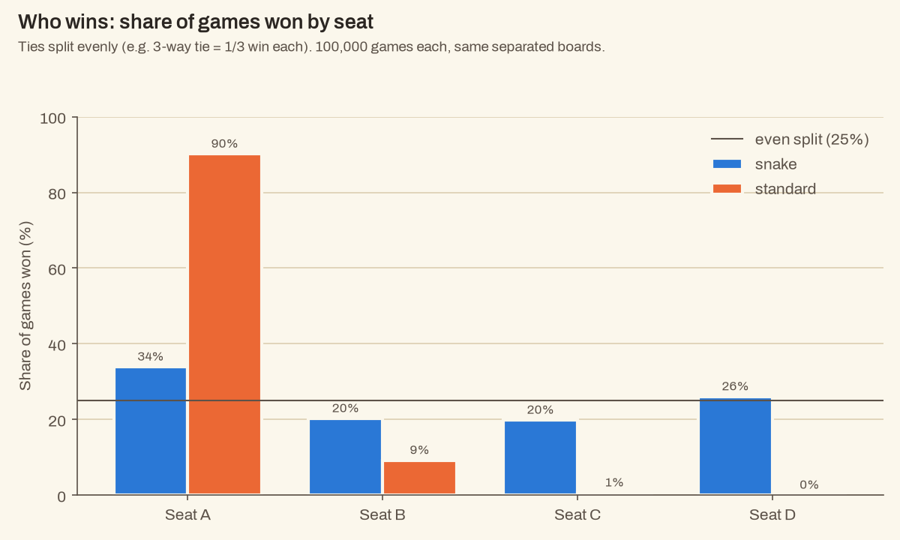
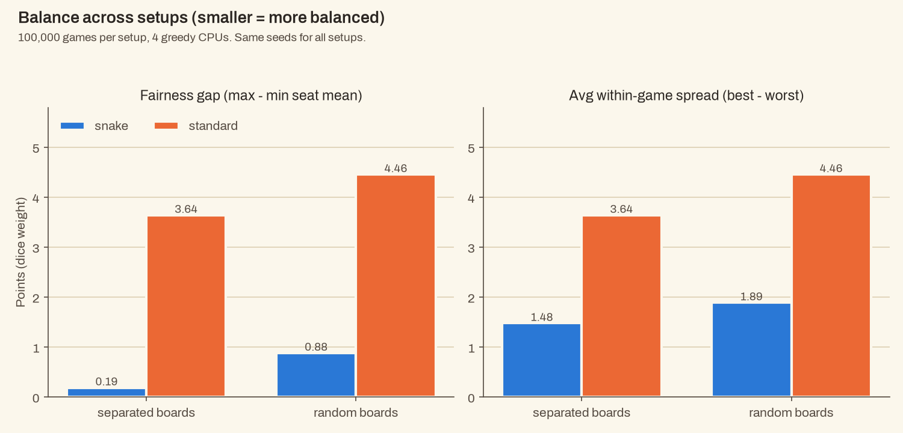
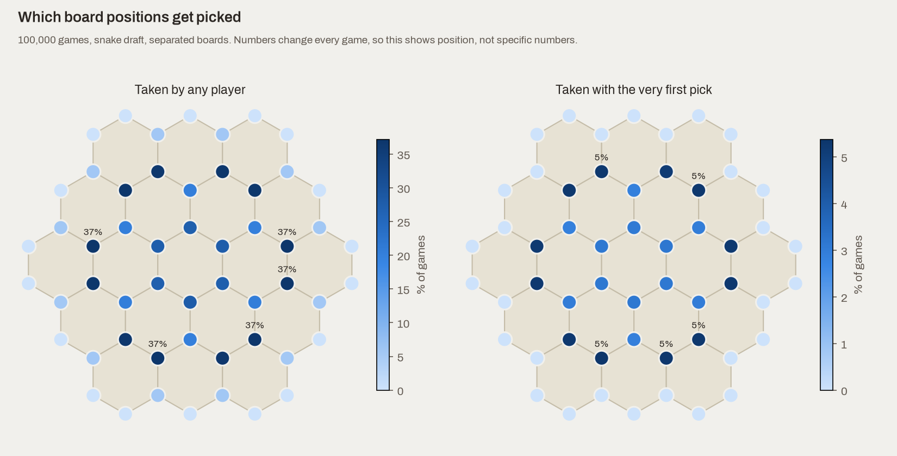

# Experiments: draft order and board layout

## Questions

1. **Draft position:** under the snake draft, does any seat (A, B, C, D) still do better on average?
2. **Snake vs standard:** how much does the snake draft (A B C D D C B A) close the gap between
   seats compared with the standard order (A B C D A B C D)?
3. **Board layout:** are boards where no 6 or 8 touches another 6 or 8 ("separated") fairer than
   fully random boards?

## How the experiments were run

- Four computer players, all greedy: on each turn they take the most valuable open spot. When
  several spots are tied, one is picked at random (from a seeded random number generator, so it's
  repeatable).
  - Greedy is a simple rule of thumb, not the best possible play, so the results describe greedy
    players.
- A player's payoff is the total dice weight around their 2 settlements, i.e. how much they expect
  to produce, not actual resources collected.
- 4 setups: {snake, standard} x {separated, random}.
- 100,000 games per setup, using seeds 0 to 99,999.
  - Game `i` uses seed `i` in every setup.
  - The board only depends on the seed and the board type, so snake and standard are played on
    **the same 100,000 boards**. The draft order is the only thing that changes, which makes the
    comparison very direct.
  - Separated and random boards are different boards, since separated mode throws out layouts that
    random mode allows.
- Reproduce everything: `python main.py experiments --games 100000 --seed 0`.
- Replay any single game: `python main.py play --seed <seed> --board <mode> --draft <draft>`.

## What was measured

- **Average payoff per seat**, with a 95% confidence interval: the range the true average almost
  certainly falls in. With 100,000 games it's tiny, about +/- 0.006 to 0.01 points.
- **Fairness gap** = best seat's average minus worst seat's average. Smaller means the seats are
  closer on average.
- **Within-game spread** = best payoff minus worst payoff in a single game, averaged over all games.
  This catches games that are lopsided even when the averages look even.
- **Win share** = how often each seat wins. If k players tie for first, each gets 1/k of a win.
- **1st and 2nd pick value** per seat, which shows *where* each seat's payoff comes from.
- **Board heatmap** = how often each spot gets taken, which shows the spots greedy players like.

Note: the fairness gap is one way to measure balance. A small gap doesn't prove a draft is fair in
every sense.

## Results (100,000 games per setup)

Full tables: [results/summary.md](../results/summary.md). Every confidence interval below is
+/- 0.01 or smaller, so all of these differences are real for greedy players and not just noise.

| Setup | A | B | C | D | Fairness gap | Avg within-game spread |
|---|---|---|---|---|---|---|
| snake, separated | 20.71 | 20.55 | 20.53 | 20.52 | **0.19** | 1.48 |
| standard, separated | 22.44 | 21.14 | 19.94 | 18.80 | 3.64 | 3.64 |
| snake, random | 21.64 | 21.09 | 20.86 | 20.76 | 0.88 | 1.89 |
| standard, random | 23.43 | 21.69 | 20.26 | 18.97 | 4.46 | 4.46 |

(The seat columns are average payoffs.)

### 1. Draft position (snake)

- The seats end up very close: 20.71 / 20.55 / 20.53 / 20.52 on separated boards.
- Why: the snake draft reverses the order for the second pick.
  - 1st pick: A 12.47 > B 11.75 > C 11.15 > D 10.55 (picking earlier gets a better spot)
  - 2nd pick: A 8.24 < B 8.80 < C 9.38 < D 9.97 (D picks twice in a row, A picks last)
- The balance isn't perfect. A's first-pick lead over D (1.92) is a bit bigger than D's second-pick
  lead over A (1.73), so A keeps a small edge of 0.19 points.
- That small edge still shows up in wins: A 34%, B 20%, C 20%, D 26% (ties split). A small
  difference in averages turns into noticeably more wins.

### 2. Snake vs standard

- The standard draft gives a strict ladder: A 22.44 > B 21.14 > C 19.94 > D 18.80. The gap is 3.64,
  compared with 0.19 for snake.
- Comparing the same boards game by game, snake shrinks the best-vs-worst spread by **2.16 +/- 0.007**
  points per game on separated boards and 2.57 +/- 0.008 on random boards.
- With the standard order and greedy players, **A can never score below anyone**:
  - Spot values only go down as the game goes on, since good spots get taken and nothing new opens up.
  - In A B C D A B C D, each of A's picks comes before B's matching pick, B's before C's, and so on,
    so each is worth at least as much.
  - So A finishes first (alone or tied) in every game. With ties split, A's win share is 90%, and
    D can never win outright.
- Interesting detail: with greedy players, **both drafts take the exact same 8 spots in the same
  order** (checked on 5,000 boards, and by a test). The draft order doesn't change *which* spots get
  picked, only *who* gets each one. That's why the 2nd-pick values in the two drafts are the same
  four numbers, just handed to opposite seats.

### 3. Board layout (separated vs random)

- Keeping 6s and 8s apart cuts the snake fairness gap from 0.88 to 0.19 (about 4x smaller), and the
  within-game spread from 1.89 to 1.48.
- It also helps the standard order (gap 4.46 -> 3.64), but standard is still far less balanced.
- Likely reason: on random boards, 6s and 8s can sit together and create one "super spot". A's first
  pick is worth 13.39 on random boards vs 12.47 on separated ones, while the later seats' picks
  barely change. Separating them flattens the top of the board, so going first matters less.
- Side effect: average payoffs are a bit lower on separated boards, since there are fewer stacked
  high-value spots.

### Board heatmap

- Corners on the coast (touching 1 or 2 tiles) are almost never taken; inland corners (3 tiles) are.
- The most popular spots form a ring around the centre hex (taken in about 37% of games each), rather
  than the centre hex's own corners. One possible reason: the centre corners sit close together, so a
  settlement there blocks several others.

## Takeaways

- The snake draft works well: it cuts the gap between seats from about 3.6-4.5 points to about
  0.2-0.9, and turns a near-certain win for A into a much more even split.
- It isn't perfectly fair: A keeps a small but consistent edge, mostly visible in win share.
- Keeping 6s and 8s apart brings the snake draft much closer to even (gap 0.19).
- Limits: these are greedy players only. Players who think ahead or block on purpose (Issue #6)
  could change the picture, and then the draft order could also change *which* spots get taken.
